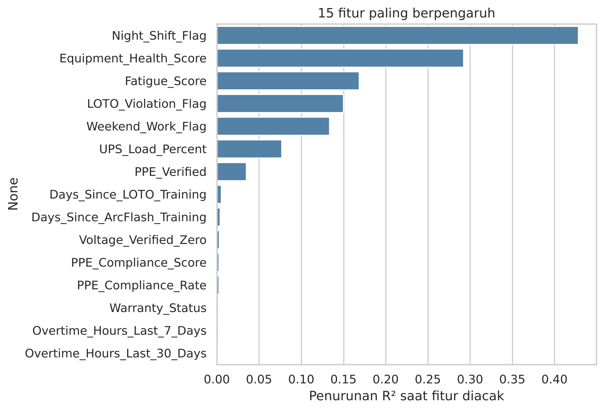
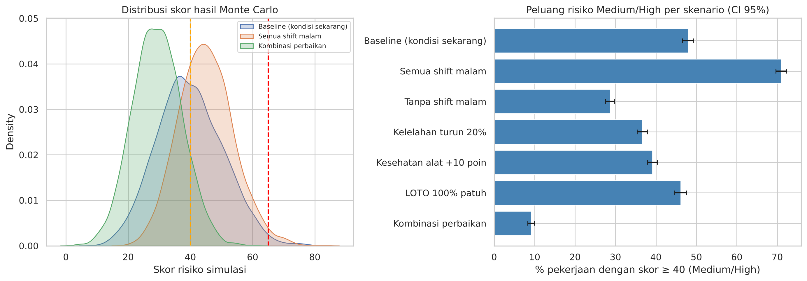
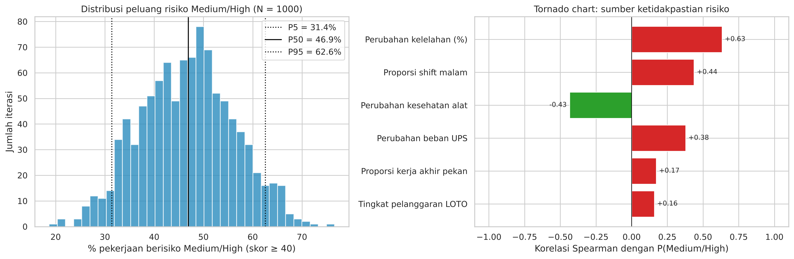

# Erik Setiawan-Uas ADKP Electrical Safety Monte Carlo

**Prediksi Skor Risiko Keselamatan Listrik + Simulasi Monte Carlo**

[](https://colab.research.google.com/github/eriksetiawan018-Maverick/Erik-Setiawan-UAS-ADKP-Electrical-Safety-/blob/main/Erik%20Setiawan-Uas%20ADKP%20Electrical%20Safety%20Monte%20Carlo.ipynb)

* **Penulis:** Erik Setiawan (NPM: 2506564102)
* **Program Studi:** S2 Teknik Kimia — Manajemen Keselamatan Proses
* **Mata Kuliah:** Analisis Data Keselamatan Proses (UAS)

---

Model yang dibuat adalah gabungan **model regresi (machine learning)** dan **simulasi Monte Carlo** untuk menilai risiko keselamatan kerja listrik di data center.

Semua kode ada di notebook [`Erik Setiawan-Uas ADKP Electrical Safety Monte Carlo.ipynb`](Erik%20Setiawan-Uas%20ADKP%20Electrical%20Safety%20Monte%20Carlo.ipynb) dan dikerjakan di Google Colab.

---

## 1. Tujuan

1. Memprediksi **`Electrical_Safety_Risk_Score`** (skor risiko keselamatan listrik, skala 0–100) dari data pekerja, pekerjaan, peralatan, dan lingkungan.
2. Mencari **faktor yang paling memengaruhi** skor risiko.
3. Memakai model tersebut dalam **simulasi Monte Carlo** untuk menjawab pertanyaan *what-if*, misalnya: *"Berapa persen pekerjaan yang berisiko Medium/High kalau shift malam dihindari?"*
4. Mengkuantifikasi **ketidakpastian** risiko secara probabilistik dan mengidentifikasi variabel paling sensitif melalui **tornado chart** (korelasi peringkat Spearman).

## 2. Data

- **Sumber:** Kaggle, file `electrical_safety_5000.csv`
- **Ukuran:** 5.000 baris × 200 kolom (catatan pekerjaan listrik di 5 data center)
- **Isi:** data pekerja (pengalaman, sertifikasi, kelelahan, lembur), pekerjaan (jenis, shift, izin kerja), keselamatan (APD, LOTO), kondisi peralatan, besaran listrik, suhu ruangan, dan hasil audit.
- **Target:** `Electrical_Safety_Risk_Score`. Kategori risiko di dataset: **Low** (< 40), **Medium** (40–65), **High** (> 65).
- **Catatan:** distribusi kategorinya sangat merata, jadi dataset ini kemungkinan besar **data sintetis**. Hasilnya menggambarkan pola dalam data, bukan kondisi data center nyata.

## 3. Metode

### a. Pembersihan data
Kolom berikut **dibuang** dari fitur supaya model jujur dan tidak "nyontek":

| Jenis kolom | Contoh | Alasan |
|---|---|---|
| Bocoran target | `Predictive_Risk_Score` (korelasi 1,0), `Probability_of_Incident` (0,97), `Risk_Level` | Turunan langsung dari target |
| Hasil insiden | `Injury_Occurred`, `Equipment_Damage`, `Root_Cause` | Baru diketahui setelah kejadian |
| ID, tanggal, teks | `Incident_ID`, `Audit_Date`, `Lessons_Learned` | Tidak bermakna sebagai fitur angka |
| Indeks gabungan/duplikat | `Fatigue_Index` (= `Fatigue_Score`), `Electrical_Exposure_Score` (≈ `UPS_Load_Percent`), `Apparent_Power_kVA` (dari tegangan × arus) | Informasi ganda yang bikin model tidak stabil |
| Konstan | `Fatality_Flag`, `Hard_Hat` | Nilainya sama semua |

Sisa fitur: **120 numerik + 19 kategorik**. Fitur numerik distandarkan (`StandardScaler`) dan fitur kategorik diubah jadi one-hot (`OneHotEncoder`). Data dibagi **80% train, 20% test**.

### b. Model regresi
Empat model dibandingkan, dievaluasi dengan 5-fold cross validation dan data test:

| Model | CV R² (train) | MAE (test) | RMSE (test) | R² (test) |
|---|---|---|---|---|
| **Ridge Regression** | 0,753 | 4,05 | 5,09 | **0,772** |
| Linear Regression | 0,752 | 4,05 | 5,09 | 0,772 |
| Gradient Boosting | 0,73 | 4,1–4,2 | 5,2 | ≈ 0,76* |
| Random Forest | 0,699 | 4,32 | 5,47 | 0,736 |

\*Hasil Gradient Boosting bisa sedikit berbeda (0,757–0,762) tergantung versi scikit-learn.

Model terbaik adalah **Ridge Regression** (regresi linear dengan regularisasi). Rata-rata prediksinya meleset sekitar **4 poin** dari skor sebenarnya.

**Formulasi.** Skor risiko pekerjaan ke-$i$ dimodelkan sebagai kombinasi linear fitur yang sudah distandarkan:

$$
\hat{y}_i = \beta_0 + \sum_{j=1}^{p} \beta_j x_{ij}
$$

Koefisien $\beta$ dicari dengan meminimalkan galat kuadrat ditambah penalti L2 (Hoerl & Kennard, 1970):

$$
\min_{\beta} \sum_{i=1}^{n} (y_i - \hat{y}_i)^2 + \alpha \sum_{j=1}^{p} \beta_j^2, \qquad \alpha = 10
$$

Metrik evaluasi:

$$
\text{MAE} = \frac{1}{n}\sum |y_i - \hat{y}_i|, \qquad \text{RMSE} = \sqrt{\frac{1}{n}\sum (y_i - \hat{y}_i)^2}, \qquad R^2 = 1 - \frac{\sum (y_i - \hat{y}_i)^2}{\sum (y_i - \bar{y})^2}
$$


### c. Faktor paling berpengaruh
Diukur dengan **permutation importance** (seberapa turun R² kalau satu fitur diacak). Faktor teratas: **shift malam**, **kesehatan peralatan**, **tingkat kelelahan pekerja**, **pelanggaran LOTO**, **kerja akhir pekan**, dan **beban UPS**.



### d. Simulasi Monte Carlo — skenario *what-if* (deterministik)
Satu simulasi untuk satu skenario:
1. Ambil acak **5.000 pekerjaan** dari data (bootstrap, dengan pengembalian), sehingga hubungan antar-variabel tetap realistis.
2. Ubah variabel sesuai skenario (misalnya `Night_Shift_Flag = 0`).
3. Prediksi skor dengan model Ridge.
4. Tambahkan **noise acak dari residual model**, supaya ketidakpastian model ikut dihitung.
5. Hitung rata-rata skor, peluang Medium/High (skor ≥ 40), dan peluang High (skor > 65).

Langkah ini diulang **200 kali** per skenario untuk mendapatkan rata-rata dan **interval kepercayaan 95%**. Secara matematis:

$$
\tilde{y}_k = f(\mathbf{x}_k^{\text{skenario}}) + \varepsilon_k, \qquad \hat{P}(\tilde{y} \geq 40) = \frac{1}{N}\sum_{k=1}^{N} \mathbf{1}[\tilde{y}_k \geq 40]
$$

dengan $f$ model Ridge dan $\varepsilon_k$ diambil acak dari residual data test.

### e. Simulasi Monte Carlo — analisis ketidakpastian probabilistik
Di dunia nyata kondisi operasi tidak pasti, jadi 6 kondisi diperlakukan sebagai **variabel acak**:

| Variabel ketidakpastian | Distribusi | Min | Mode | Maks |
|---|---|---|---|---|
| Proporsi pekerjaan shift malam | Segitiga | 0,20 | 0,46 | 0,70 |
| Proporsi kerja akhir pekan | Segitiga | 0,10 | 0,29 | 0,50 |
| Perubahan skor kelelahan (%) | Segitiga | −30 | 0 | +20 |
| Perubahan kesehatan alat (poin) | Segitiga | −10 | 0 | +10 |
| Tingkat pelanggaran LOTO | Uniform | 0,00 | – | 0,10 |
| Perubahan beban UPS (poin %) | Uniform | −10 | – | +10 |

Nilai *mode* diambil dari kondisi di data. Setiap iterasi (total **N = 1.000**): ambil satu nilai acak per variabel, bootstrap 2.000 pekerjaan dan terapkan kondisinya (shift malam, akhir pekan, dan pelanggaran LOTO diundi per pekerjaan dengan distribusi Bernoulli), prediksi skor dengan model Ridge, tambahkan noise residual, lalu simpan peluang risiko Medium/High. Sensitivitas tiap variabel diukur dengan **korelasi peringkat Spearman** (ρ) terhadap peluang Medium/High.

## 4. Hasil simulasi

| Skenario | Rata-rata skor | P(Medium/High) | P(High) |
|---|---|---|---|
| Baseline (kondisi sekarang) | 39,8 | 48,0% | 1,2% |
| Semua shift malam | 45,1 | 70,9% | 2,0% |
| Tanpa shift malam | 35,4 | 28,7% | 0,2% |
| Kelelahan turun 20% | 36,8 | 36,6% | 0,6% |
| Kesehatan alat +10 poin | 37,5 | 39,2% | 0,7% |
| LOTO 100% patuh | 39,2 | 46,1% | 0,5% |
| **Kombinasi perbaikan** | **29,3** | **9,1%** | **0,0%** |



**Kesimpulan:**
- Shift malam adalah faktor dengan efek terbesar: menghindarinya menurunkan peluang risiko Medium/High dari 48% ke sekitar 29%.
- Mengurangi kelelahan dan merawat peralatan juga menurunkan risiko secara nyata.
- Kepatuhan LOTO penuh efeknya kecil di sini karena pelanggaran LOTO di data hanya sekitar 4%, tapi tetap menurunkan peluang risiko High.
- Kalau semua perbaikan digabung, peluang Medium/High turun drastis ke sekitar 9%.

### Hasil analisis probabilistik (N = 1.000)

| Output | Mean | P5 | P50 (median) | P95 |
|---|---|---|---|---|
| Rata-rata skor | 39,45 | 35,48 | 39,52 | 43,56 |
| P(Medium/High) | 46,7% | 31,4% | 47,0% | 62,6% |
| P(High) | 1,0% | 0,2% | 0,9% | 2,4% |



- Dengan kondisi operasi yang tidak pasti, peluang pekerjaan berisiko Medium/High berada di rentang **31–63%** (P5–P95). Pada sekitar **37%** iterasi, lebih dari separuh pekerjaan masuk kategori Medium/High.
- **Tornado chart:** sumber ketidakpastian terbesar adalah **perubahan kelelahan pekerja** (ρ = +0,63), disusul **proporsi shift malam** (+0,44), **kesehatan alat** (−0,43), dan **beban UPS** (+0,38). Kerja akhir pekan (+0,17) dan pelanggaran LOTO (+0,16) pengaruhnya lebih kecil.
- **Rekomendasi:** program **manajemen kelelahan** dan **pengaturan shift** adalah pengendalian paling efektif, diikuti perawatan peralatan.

## 5. Keterbatasan
- Dataset kemungkinan sintetis, jadi hasilnya adalah pola dalam data, bukan bukti sebab-akibat.
- Skenario hanya mengubah variabel tertentu tanpa mengubah variabel lain yang di dunia nyata mungkin ikut berubah (misalnya shift malam bisa ikut menaikkan kelelahan).
- Batas kategori 40 dan 65 diambil dari kolom `Risk_Level` di dataset.
- Rentang distribusi pada analisis probabilistik adalah asumsi penulis berdasarkan nilai di data, bukan hasil pengukuran lapangan.

## 6. Cara menjalankan
1. Buka notebook di Google Colab (tombol **Open in Colab** di GitHub, atau *File → Upload notebook* di Colab).
2. Upload `electrical_safety_5000.csv` ke panel **Files** di Colab, atau jalankan sel pemuatan data lalu pilih file saat diminta.
3. Pilih **Runtime → Run all**. Seluruh notebook selesai sekitar 2–4 menit.

Library yang dipakai (sudah tersedia di Colab): `pandas`, `numpy`, `scipy`, `scikit-learn`, `matplotlib`, `seaborn`.

## 7. Struktur repository
```
├── Erik Setiawan-Uas ADKP Electrical Safety Monte Carlo.ipynb   # notebook utama (kode + penjelasan + hasil)
├── electrical_safety_5000.csv            # dataset dari Kaggle
├── Images/                               # gambar hasil untuk README
├── requirements.txt
└── README.md
```

## 8. Referensi
1. Dataset: *Electrical Safety* (`electrical_safety_5000.csv`), Kaggle.
2. Hoerl, A. E., & Kennard, R. W. (1970). Ridge regression: Biased estimation for nonorthogonal problems. *Technometrics*, 12(1), 55–67.
3. Breiman, L. (2001). Random forests. *Machine Learning*, 45(1), 5–32.
4. Pedregosa, F., et al. (2011). Scikit-learn: Machine learning in Python. *Journal of Machine Learning Research*, 12, 2825–2830.
5. Metropolis, N., & Ulam, S. (1949). The Monte Carlo method. *Journal of the American Statistical Association*, 44(247), 335–341.
6. Efron, B. (1979). Bootstrap methods: Another look at the jackknife. *The Annals of Statistics*, 7(1), 1–26.
7. Spearman, C. (1904). The proof and measurement of association between two things. *The American Journal of Psychology*, 15(1), 72–101.
8. NFPA 70E (2024). *Standard for Electrical Safety in the Workplace*. National Fire Protection Association.
9. OSHA 29 CFR 1910.147. *The Control of Hazardous Energy (Lockout/Tagout)*. U.S. Department of Labor.

## 9. Catatan
Kode dan README ini dibuat dengan bantuan AI, lalu dibaca, dijalankan, dan dipahami oleh penulis.
