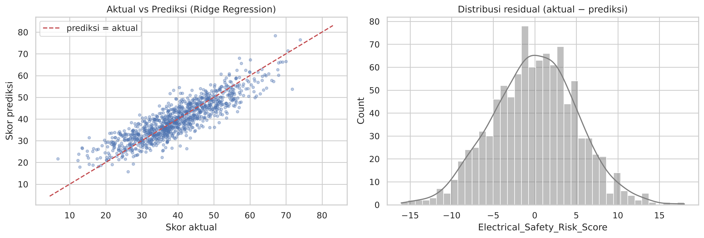

# Erik Setiawan-Uas ADKP Electrical Safety Monte Carlo

**Prediksi Skor Risiko Keselamatan Listrik + Simulasi Monte Carlo**

Proyek UAS mata kuliah **ADKP**. Model yang dibuat adalah gabungan **model regresi (machine learning)** dan **simulasi Monte Carlo** untuk menilai risiko keselamatan kerja listrik di data center.

Semua kode ada di notebook [`Erik Setiawan-Uas ADKP Electrical Safety Monte Carlo.ipynb`](Erik%20Setiawan-Uas%20ADKP%20Electrical%20Safety%20Monte%20Carlo.ipynb) dan dikerjakan di Google Colab.

---

## 1. Tujuan

1. Memprediksi **`Electrical_Safety_Risk_Score`** (skor risiko keselamatan listrik, skala 0–100) dari data pekerja, pekerjaan, peralatan, dan lingkungan.
2. Mencari **faktor yang paling memengaruhi** skor risiko.
3. Memakai model tersebut dalam **simulasi Monte Carlo** untuk menjawab pertanyaan *what-if*, misalnya: *"Berapa persen pekerjaan yang berisiko Medium/High kalau shift malam dihindari?"*

## 2. Data

- **Sumber:** Kaggle, file `electrical_safety_5000.csv`
- **Ukuran:** 5.000 baris × 200 kolom (catatan pekerjaan listrik di 5 data center)
- **Isi:** data pekerja (pengalaman, sertifikasi, kelelahan, lembur), pekerjaan (jenis, shift, izin kerja), keselamatan (APD, LOTO), kondisi peralatan, besaran listrik, suhu ruangan, dan hasil audit.
- **Target:** `Electrical_Safety_Risk_Score`. Kategori risiko di dataset: **Low** (< 40), **Medium** (40–65), **High** (> 65).
- **Catatan:** distribusi kategorinya sangat merata, jadi dataset ini kemungkinan besar **data sintetis**. Hasilnya menggambarkan pola dalam data, bukan kondisi data center nyata.

## 3. Metode

### a. Pembersihan data
Kolom berikut **dibuang** dari fitur supaya model jujur dan tidak "nyontek":

| Jenis kolom | Contoh | Alasan |
|---|---|---|
| Bocoran target | `Predictive_Risk_Score` (korelasi 1,0), `Probability_of_Incident` (0,97), `Risk_Level` | Turunan langsung dari target |
| Hasil insiden | `Injury_Occurred`, `Equipment_Damage`, `Root_Cause` | Baru diketahui setelah kejadian |
| ID, tanggal, teks | `Incident_ID`, `Audit_Date`, `Lessons_Learned` | Tidak bermakna sebagai fitur angka |
| Indeks gabungan/duplikat | `Fatigue_Index` (= `Fatigue_Score`), `Electrical_Exposure_Score` (≈ `UPS_Load_Percent`), `Apparent_Power_kVA` (dari tegangan × arus) | Informasi ganda yang bikin model tidak stabil |
| Konstan | `Fatality_Flag`, `Hard_Hat` | Nilainya sama semua |

Sisa fitur: **120 numerik + 19 kategorik**. Fitur numerik distandarkan (`StandardScaler`) dan fitur kategorik diubah jadi one-hot (`OneHotEncoder`). Data dibagi **80% train, 20% test**.

### b. Model regresi
Empat model dibandingkan, dievaluasi dengan 5-fold cross validation dan data test:

| Model | CV R² (train) | MAE (test) | RMSE (test) | R² (test) |
|---|---|---|---|---|
| **Ridge Regression** | 0,753 | 4,05 | 5,09 | **0,772** |
| Linear Regression | 0,752 | 4,05 | 5,09 | 0,772 |
| Gradient Boosting | 0,727 | 4,17 | 5,25 | 0,757 |
| Random Forest | 0,699 | 4,32 | 5,47 | 0,736 |

Model terbaik adalah **Ridge Regression** (regresi linear dengan regularisasi). Rata-rata prediksinya meleset sekitar **4 poin** dari skor sebenarnya.



### c. Faktor paling berpengaruh
Diukur dengan **permutation importance** (seberapa turun R² kalau satu fitur diacak). Faktor teratas: **shift malam**, **kesehatan peralatan**, **tingkat kelelahan pekerja**, **pelanggaran LOTO**, **kerja akhir pekan**, dan **beban UPS**.


### d. Simulasi Monte Carlo
Satu simulasi untuk satu skenario:
1. Ambil acak **5.000 pekerjaan** dari data (bootstrap, dengan pengembalian), sehingga hubungan antar-variabel tetap realistis.
2. Ubah variabel sesuai skenario (misalnya `Night_Shift_Flag = 0`).
3. Prediksi skor dengan model Ridge.
4. Tambahkan **noise acak dari residual model**, supaya ketidakpastian model ikut dihitung.
5. Hitung rata-rata skor, peluang Medium/High (skor ≥ 40), dan peluang High (skor > 65).

Langkah ini diulang **200 kali** per skenario untuk mendapatkan rata-rata dan **interval kepercayaan 95%**.

## 4. Hasil simulasi

| Skenario | Rata-rata skor | P(Medium/High) | P(High) |
|---|---|---|---|
| Baseline (kondisi sekarang) | 39,8 | 48,0% | 1,2% |
| Semua shift malam | 45,1 | 70,9% | 2,0% |
| Tanpa shift malam | 35,4 | 28,7% | 0,2% |
| Kelelahan turun 20% | 36,8 | 36,6% | 0,6% |
| Kesehatan alat +10 poin | 37,5 | 39,2% | 0,7% |
| LOTO 100% patuh | 39,2 | 46,1% | 0,5% |
| **Kombinasi perbaikan** | **29,3** | **9,1%** | **0,0%** |


**Kesimpulan:**
- Shift malam adalah faktor dengan efek terbesar: menghindarinya menurunkan peluang risiko Medium/High dari 48% ke sekitar 29%.
- Mengurangi kelelahan dan merawat peralatan juga menurunkan risiko secara nyata.
- Kepatuhan LOTO penuh efeknya kecil di sini karena pelanggaran LOTO di data hanya sekitar 4%, tapi tetap menurunkan peluang risiko High.
- Kalau semua perbaikan digabung, peluang Medium/High turun drastis ke sekitar 9%.

## 5. Keterbatasan
- Dataset kemungkinan sintetis, jadi hasilnya adalah pola dalam data, bukan bukti sebab-akibat.
- Skenario hanya mengubah variabel tertentu tanpa mengubah variabel lain yang di dunia nyata mungkin ikut berubah (misalnya shift malam bisa ikut menaikkan kelelahan).
- Batas kategori 40 dan 65 diambil dari kolom `Risk_Level` di dataset.

## 6. Cara menjalankan
1. Buka notebook di Google Colab (tombol **Open in Colab** di GitHub, atau *File → Upload notebook* di Colab).
2. Upload `electrical_safety_5000.csv` ke panel **Files** di Colab, atau jalankan sel pemuatan data lalu pilih file saat diminta.
3. Pilih **Runtime → Run all**. Seluruh notebook selesai sekitar 2–4 menit.

Library yang dipakai (sudah tersedia di Colab): `pandas`, `numpy`, `scikit-learn`, `matplotlib`, `seaborn`.

## 7. Struktur repository
```
├── Erik Setiawan-Uas ADKP Electrical Safety Monte Carlo.ipynb   # notebook utama (kode + penjelasan + hasil)
├── electrical_safety_5000.csv            # dataset dari Kaggle
├── Images/                               # gambar hasil untuk README
├── requirements.txt
└── README.md
```

## 8. Catatan
Kode dan README ini dibuat dengan bantuan AI, lalu dibaca, dijalankan, dan dipahami oleh penulis.
